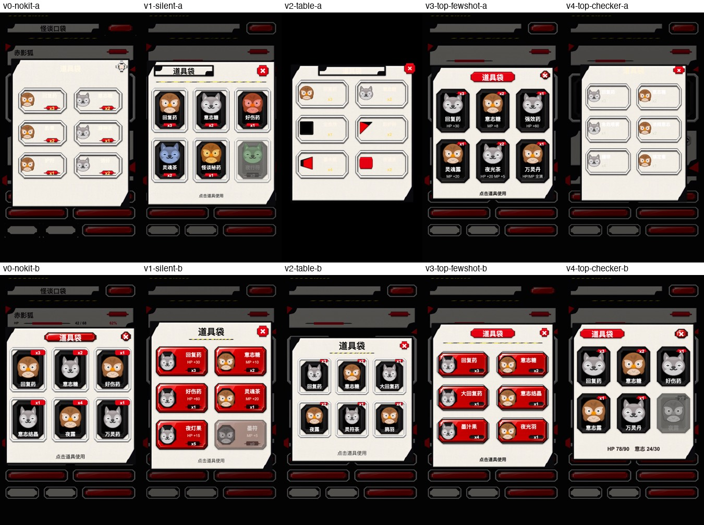
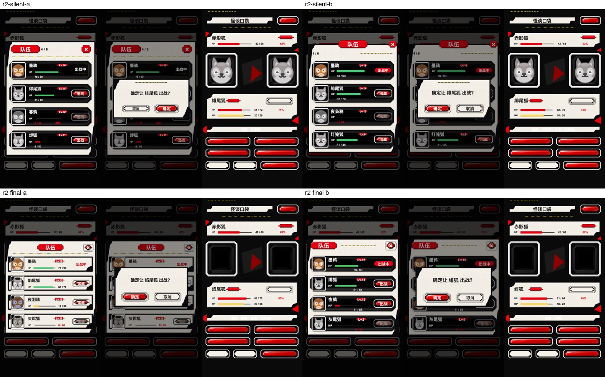
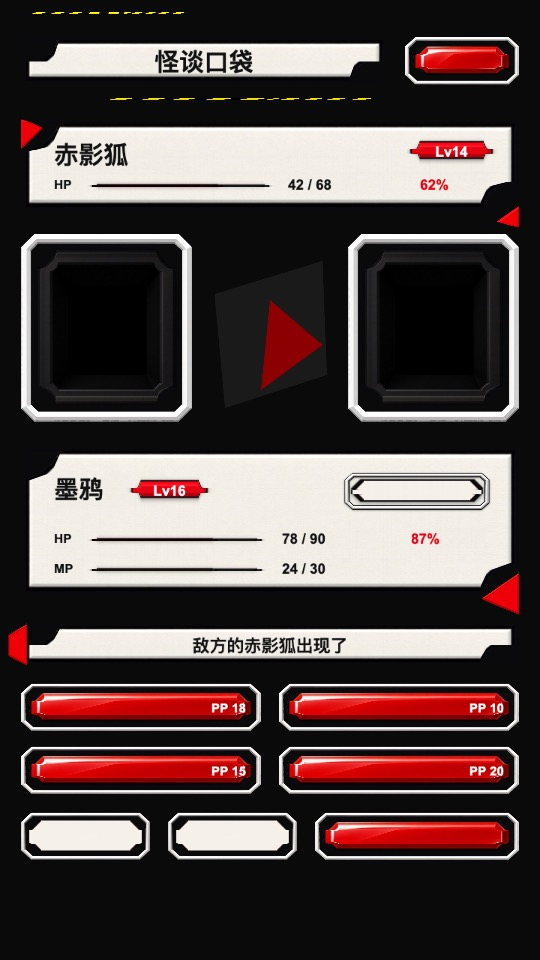

# 实验：LLM 能不能直接手写 Cocos Creator 3.8 预制体

记录日期 2026-10-02。Enji 0.3.0，Cocos Creator 3.8 运行时（Enji host 预览）。

## 结论

**能，而且很稳。** 5 档难度 × 有/无范例 × 2 次重复，共 20 个独立子代理：

- 18 个运行时满分（逐项对比节点树和组件属性）。
- 20 个全部第一次就通过 `enji import` 和 `enji check`，静态结构校验全部干净，`__id__` 引用零错误。
- 2D 四档的 16 个产物渲染出来，和参考预制体的截图**逐像素相同**（PNG 的 MD5 一致）。
- 唯一的失分是 3D 档无范例组的两次，原因完全相同：Cocos 灯光强度在运行时读取旧字段名 `_illuminance` / `_luminance`，只写新字段 `_illuminanceHDR` / `_luminanceHDR` 会被静默忽略。导入和检查都发现不了。有范例组从 `Lamp.prefab` 里看到旧字段，两次都写对了。

这推翻了此前的两个判断：一是"LLM 手写不了可靠的大预制体"（这是我未经测试的断言），二是由它推出的"叶子预制体 kit + 代码拼装"方案。Enji 不需要为预制体发明新概念；需要补的是**反馈**：`enji check` 不检查字段名，写错的属性只在运行时才会表现为默认值。

## 1. 背景

起点是 phantom-pocket（P5 风格类宝可梦 demo，在 enji-demos 仓库）。它的战斗 HUD 由 auto-ui-pipeline 生成 `uilayout.json`，再由 `UiTree.ts` 在运行时 `new Node` + `addComponent` 拼出 Cocos 节点树。用户问"为什么没用 prefab"，于是做了两轮实验。

### 1.1 前序实验：叶子预制体 kit + 提示词变体（已被本实验推翻）

当时的前提是"LLM 写不好整屏预制体"，所以设计了一套 kit：5 个只挂一个组件的叶子预制体（`UiSprite`、`UiLabel`、`UiHit`、`UiBar`、`UiBlocker`）加一个 TypeScript helper 模块，由代码组装界面。用 14 份隔离副本测"怎样的提示词能让 LLM 用 kit 而不是 `new Node`"：

| 第一轮变体（道具袋任务，各 2 次） | 预制体实例占比 | `new Node` / `addComponent` | 改动 kit | 文字看不见 |
|---|---|---|---|---|
| 没有 kit | 0% / 80% | 30 / 5 | — | 1/2 |
| 有 kit，文档完全不提 | 100% / 100% | 0 | 2/2 | 0/2 |
| 表格式文档 | 100% / 100% | 0 | 1/2 | 1/2 |
| 顶部硬规则 + 代码示例 | 100% / 100% | 0 | 2/2 | 0/2 |
| 上一行再加检查脚本 | 100% / 100% | 0 | 1/2 | 1/2 |



结论是"kit 存在 + 现有代码已经在用它"决定合规，提示词措辞几乎没影响。第二轮修好 kit 后，4 个运行都 100% 用预制体。这套方案当时被移植进 phantom-pocket 和 Enji 模板的 `AGENTS.md`。



这轮实验回答的是"怎么让 LLM 用 kit"，从没检验过它的前提"LLM 写不好预制体"。用户指出：Enji 不应该创造新概念，应该直接测 LLM 写预制体的能力，"其实我感觉 llm 写 prefab 没有你想像中那么困难"。于是有了本实验。

## 2. 实验设计

### 2.1 问题与假设

- 问题：给出明确的节点树规格，LLM 能否直接产出可在运行时正确实例化、属性正确的 `.prefab` JSON？难度上升时在哪里失败？
- 原假设（我的旧判断）：节点一多，`__id__` 引用、PrefabInfo/CompPrefabInfo、组件字段会出错。
- 对立假设（用户）：难度不高。

### 2.2 难度分档

| 档 | 预制体 | 节点 | 组件 | 检查项 | 考什么 |
|---|---|---|---|---|---|
| T1 | Badge | 2 | 4 | 28 | Sprite / Label 基本序列化、`<uuid>@f9941` 精灵帧引用、UI_2D 层 |
| T2 | ItemSlot | 7 | 14 | 91 | Button（target 指向自身）、SLICED 九宫格、三层嵌套、Label 颜色 |
| T3 | BagDialog | 50 | 101 | 659 | Layout GRID 全部参数（运行时会重新排版，参数错了位置就错）、BlockInputEvents、Button SCALE、深层路径 |
| T4 | BattleScreen | 77 | 145 | 951 | 不给节点树，只给 `uilayout.json` 和 9 条转换规则：坐标系换算（左上原点 → 父节点中心）、按 z 稳定排序、按 kind 选 Sprite 类型、bar 追加锚点 (0, 0.5) 的 Fill |
| T5 | LightRig（3D） | 7 | 5 | 61 | DirectionalLight / SphereLight / SpotLight / LightProbeGroup（18 个探针坐标）/ ReflectionProbe、欧拉角 → 四元数、无 UITransform、DEFAULT 层 |

规格在 `scripts/tiers.py` 里定义为一棵语义节点树，同一份定义生成三样东西：给子代理的 `TASK.md`、评分用的 `expected.json`、参考预制体（oracle）。

### 2.3 条件与样本

- **A 组（有范例）**：2D 项目里保留 kit 的 5 个叶子预制体（展示 Sprite/Label/UITransform/BlockInputEvents 的序列化格式，但没有 Button、Layout）；3D 项目额外放一个 `samples/Lamp.prefab`（一个 SphereLight 节点）。`TASK.md` 说明"可以读它们当格式参考"。
- **B 组（无范例）**：删除所有预制体，**同时删除 `library/` 里对应的编译产物**（否则能从缓存里找到范例）。准备完成后用 `rg '"cc.PrefabInfo"'` 确认项目内没有任何预制体 JSON。场景文件 `main.scene` 两组都有。
- 每格 2 次重复，共 5 × 2 × 2 = 20 个子代理。子代理模型与编排代理相同（Task 工具 `model: inherit`），每个在自己独立的项目副本里工作。
- 给子代理的提示词只有一句："Read `<run>/TASK.md` and complete the task it describes. Work only inside `<run>`. Follow its rules exactly and finish with the reply it asks for."

### 2.4 TASK.md 给了什么、没给什么

给了（见 `tasks/`）：输出路径；规则（只用引擎内置组件、不嵌套预制体、不手写 `.meta`、写完跑 `enji import` 和 `enji check`、不用浏览器和 git、不读项目外文件）；评分方式（运行时 `resources.load` + `instantiate` 后逐项对比）；节点树规格（尺寸、位置、组件属性用**枚举名**表示，例如 `type SLICED`、`overflow SHRINK`、`constraint FIXED_COL`）。

没给：预制体 JSON 格式、字段名、枚举数值、精灵帧子资源的引用写法（只说"uuid 在图片的 `.meta` 里"）、四元数换算公式、灯光字段的坑。可以用脚本生成，也可以手写，由子代理自选。

### 2.5 环境

- 基础项目：phantom-pocket 的 kit 版本，去掉 UI 代码，`MainView.ts` 换成测试 harness（`harness/MainView.ts`）：读取 URL 参数 `?prefab=<resources 路径>`，`resources.load` 后 `instantiate` 挂到根节点，把结果写到 `window.__harness`。
- `AGENTS.md` 换成中性版本（`harness/AGENTS.neutral.md`），Prefabs 一节只剩三条通用规则，不提 kit 和检查脚本。
- 战斗图片的 `.meta` 预先设好九宫格边距（准备夹具时唯一一处手改 meta，子代理不碰）。
- 3D 项目：同一项目在 `settings/v2/packages/engine.json` 打开 `3d`、`light-probe`、`primitive` 模块（Enji 0.3.0 的 `enji init` 不支持 `--3d`）。
- 准备脚本：`scripts/prepare_base.sh`、`scripts/make_tasks.py`。

### 2.6 评分

`scripts/grade_all.py` 对每个运行依次做：

1. **静态结构校验**（`validate.py`）：JSON 合法；首元素是 `cc.Prefab`；所有 `__id__` 在范围内；父子双向一致；组件的 `node` 回指且出现在节点的 `_components` 里；每个节点有 `cc.PrefabInfo`（root 指向根、asset 指向 0），每个组件有 `cc.CompPrefabInfo`；fileId 非空且唯一；没有未被引用的元素；没有脚本组件。
2. **重新导入**：`enji import <prefab> --project <run>`。
3. **运行时导出**（`grade.mjs` + `dump.js`）：启动 Enji host，用 Playwright 驱动 Chromium 1148（`--headless=new --use-angle=swiftshader --enable-unsafe-swiftshader --ignore-gpu-blocklist`；headless shell 没有 WebGL）打开 `previewUrl&prefab=prefabs/test/<Name>`，等实例化后 800 ms（让 Layout 跑完），遍历实例化出的节点树，导出路径、子节点顺序、`position`、`rotation`、`eulerAngles`、`layer`、UITransform 尺寸和锚点，以及各组件的运行时属性（Sprite 的 `spriteFrame._uuid`、Label 的 `string`/`fontSize`/`isBold`/`overflow`、Button 的 `target` 路径、Layout 的全部参数、灯光的 `_illuminanceHDR`/`_luminanceHDR`/`size`/`range`/`_spotAngle`、探针组的 `probes` 等），然后截图。
4. **对比**（`compare.py`）：按路径匹配节点。每个节点检查：存在、子节点顺序、位置（2D ±1 px，3D ±0.01）、旋转（四元数，±1e-3，符号无关）、层、尺寸（±0.5）、锚点（±0.01），以及规格列出的每个组件属性（数值 ±1e-3，行高 ±1）。缺失节点按它的全部检查项计失败；多出的节点和组件只记录不扣分。得分 = 通过项 / 总项。

**评分器自身的验证**：先用 `tiers.py` 生成的参考预制体跑完整流程，五档都要 100%。这一步发现了灯光字段的坑（见 4.1），修正参考生成器后五档全部 100%，然后才启动子代理。

## 3. 结果

### 3.1 得分

| 档 | A-r1 | A-r2 | B-r1 | B-r2 |
|---|---|---|---|---|
| T1 Badge（28 项） | 100% | 100% | 100% | 100% |
| T2 ItemSlot（91 项） | 100% | 100% | 100% | 100% |
| T3 BagDialog（659 项） | 100% | 100% | 100% | 100% |
| T4 BattleScreen（951 项） | 100% | 100% | 100% | 100% |
| T5 LightRig（61 项） | 100% | 100% | 95.1% | 95.1% |

所有运行：静态校验 0 问题，`enji import` 成功，运行时控制台无错误（favicon 的 404 除外）。

### 3.2 子代理怎么做的

| 档 | 方法 | 生成脚本行数 | 工具调用次数 | 预制体对象数 |
|---|---|---|---|---|
| T1 | 4/4 手写 JSON | — | 7–9 | 13 |
| T2 | 4/4 写脚本（3 个 Python，1 个 Node） | 140–240 | 8–11 | 43 |
| T3 | 4/4 写 Python 脚本 | 263–286 | 9–17 | 303 |
| T4 | 4/4 写脚本（2 个 Python，2 个 Node），脚本直接读 `uilayout.json` | 145–269 | 12–14 | 445 |
| T5 | 4/4 写 Python 脚本，四元数按引擎 `Quat.fromEuler` 公式计算 | 177–233 | 8–18 | 25 |

逐个运行的数据在 `results/runs.json`，子代理的原话在 `results/agent-reports.md`，它们写的预制体和生成脚本在 `outputs/<run>/`。

- **超过两个节点就自发写脚本。** 没有任何提示，T2 起 16/16 都选择写生成器，`__id__` 交给代码分配。这是引用零错误的直接原因。
- **几乎都是一轮完成。** 20 个里 19 个只跑了一次 `enji import`。T5-A-r1 跑了 4 次，原因是测试环境的问题（见 4.3），不是预制体的问题。
- **B 组凭记忆写对了格式。** 枚举数值（Sprite SLICED=1、Label SHRINK=2、Layout GRID=3 / FIXED_COL=2、Button SCALE=3）、`<uuid>@f9941`、`_lpos`/`_lrot`/`_euler`、PrefabInfo/CompPrefabInfo 结构全部正确。
- **它们清楚自己的盲区。** 几乎每份报告都写了"字段名凭记忆，import 不校验字段名，写错只会静默退回默认值"。T5-B 两次都点名担心 `_illuminanceHDR` 这类字段，但没有办法验证。
- **报告里有事实错误，产物没有。** 两个 T4-B 子代理声称"图片 `.meta` 的九宫格边距都是 0"（实际都已设置）；T4-B-r2 报告"82 个节点"（实际 77 个，对象数和其他运行完全相同）。产物都是满分。说明报告的自述不能替代运行时检查。
- **范围**：都在项目里留下了生成脚本（规则允许放在 `assets/` 外）；没有子代理修改规格以外的文件。

### 3.3 截图

2D 四档里，每档 4 个子代理产物的截图和参考预制体的截图 MD5 完全一致。下面左边是参考预制体，右边是 B 组（无范例）子代理的产物：

| 参考（oracle） | 子代理（B 组） |
|---|---|
|  |  |
|  |  |

## 4. 失败与异常

### 4.1 灯光强度字段（真实失败，T5-B ×2）

失分的 3 项：

```text
Sun: cc.DirectionalLight.illuminanceHDR 65000 != 80000
Lamps/FillLight: cc.SphereLight.luminanceHDR 1913.84 != 2000
Lamps/RimSpot: cc.SpotLight.luminanceHDR 1913.84 != 3000
```

`_illuminanceHDR`、`_luminanceHDR` 在 `__values__` 里是可序列化字段，但带 `formerlySerializedAs('_illuminance')` / `('_luminance')`，反序列化时取值来自旧字段名。编辑器存盘时两个都写（见 Creator 自带的 `default_file_content/scene/3d.scene` 和 `default_prefab/light/*.prefab`）。只写新名字：导入成功、检查通过、实例化无报错，强度停在默认值 65000 / 1913.84。

我写参考生成器时先踩了同一个坑，是靠"评分器先跑参考预制体必须 100%"这条规矩发现的。A 组子代理从 `Lamp.prefab` 里看到 `_luminance`，四个强度字段都写了旧名，两次满分。

这是本实验里唯一能让预制体"看起来对、实际错"的问题，也是 Enji 现有检查覆盖不到的一类。

### 4.2 规格歧义（评分器问题，已更正）

T4 规则写的是 `lineHeight round(fs * 1.25)`。fs = 18 时是 `round(22.5)`：JavaScript 得 23，Python 的银行家舍入得 22。T4 第二轮两个运行最初各有 7 项"失败"，都是这个原因。改为行高容差 ±1 后用已有导出数据重算，两次都是 100%。（单行 SHRINK 文本下 22 和 23 渲染完全一样，截图也一致。）

### 4.3 测试环境的 host 指针（环境问题，不影响得分）

生成 3D A 组模板时 `enji import` 拉起了一个 host，`temp/enji-host.json` 被复制进了运行副本。T5-A-r1 第一次导入被路由到模板项目，报"path must be inside `_tmpl3dA/assets`"。子代理自己删掉了过期的指针文件，第二次导入成功。第二轮开跑前我清掉了 T5-A-r2 里的同一个文件。以后复制项目要排除 `temp/enji-host*`（`make_tasks.py` 的 `make_base` 已这样做，但模板生成之后的导入又生成了它）。

## 5. 效度威胁

- **单一模型。** 20 个子代理和编排代理是同一个模型，没有测其他模型。
- **规格是精确的数字。** 测的是"把明确的规格写成预制体"，不是"从设计稿理解布局"。T4 最接近真实流程（从 `uilayout.json` 转换），也是满分。
- **只检查列出的属性。** 没列出的属性（Button 的各状态颜色、Label 的描边等）不计分。子代理大多写了引擎默认值。
- **组件覆盖有限。** 没测 Mask、ScrollView、Widget、EditBox、RichText、Animation、ParticleSystem、MeshRenderer + 材质、嵌套预制体（Enji 规则禁止），也没测**修改**已有预制体（插入或删除节点，要重排引用）。
- **样本小。** 每格 2 次。好在结果几乎没有方差：20 次里只有一种失败模式，且在同一格内两次完全一致。
- **评分器和规格出自同一个代理。** 用参考预制体 100% 和截图逐像素一致来交叉验证。评分器在 4.1 和 4.2 都暴露过自身问题，均已修正并记录。
- **Cocos 3.8 在训练数据里很常见。** 换一个冷门引擎或私有格式，结果可能不同。

## 6. 对 Enji 的建议

1. **默认让 LLM 直接写完整预制体，不再推荐叶子 kit。** 节点多时用生成脚本（子代理会自发这样做，文档点明即可）。Enji 模板 `AGENTS.md` 里前序实验写入的"UI from leaf prefabs"一节已改为这个结论。
2. **为不常见的组件提供范例预制体。** A/B 对比里唯一的差别就来自 `Lamp.prefab`。3D 灯光、探针、相机、MeshRenderer 这类，放一份编辑器存出来的最小范例，成本很低。
3. **补一个运行时检查。** `enji check` 不检查字段名，静默字段错误只能在实例化后发现。最小做法是一个文档化的配方：URL 参数指定预制体 → 实例化 → 导出组件属性给 LLM 看（本实验的 `harness/MainView.ts` + `scripts/dump.js` 就是这个）。这是验证手段，不是新的编写概念。
4. **在 `AGENTS.md` 列出已知的静默坑。** 目前确认的：灯光强度要同时写 `_illuminance`/`_illuminanceHDR`、`_luminance`/`_luminanceHDR`；Label 的 `Overflow.NONE` 会在进场景时把宽度重置成文字宽度（前序实验发现）。

## 7. 后续可做

- 修改已有预制体：插入、删除、重排节点，改组件（考验 `__id__` 重排）。
- 依赖型组件：Mask + ScrollView + Layout 嵌套、Widget 对齐、RichText、EditBox。
- 3D 资源引用：MeshRenderer + 导入的 glTF 网格和材质、Animation 剪辑。
- 换模型重复同一套实验。
- 把第 6 条第 3 点的运行时检查做进 Enji 或模板，再测一次 T5-B 看子代理能否自己发现并修正灯光字段。

## 8. 复现

```sh
export PREFAB_WRITE=/private/tmp/prefab-write   # 用 /private 路径
bash scripts/prepare_base.sh <phantom-pocket 目录>               # 生成 _base2d / _base3d
python3 scripts/tiers.py "$PREFAB_WRITE/_spec"                  # expected.json + oracle + Lamp 范例
python3 scripts/make_tasks.py 2                                 # runs/T{1..5}-{A,B}-r{1,2} + TASK.md
# 给每个 run 起一个子代理，提示词见 2.3
# 评分（需要 playwright-core 和 Chromium 1148，grade.mjs 旁边要能解析到 node_modules）
python3 scripts/grade_all.py                                    # 结果在 $PREFAB_WRITE/_results/summary.json
```

先把参考预制体放进副本跑一遍 `grade.mjs` + `compare.py`，确认五档 100%，再评子代理的产物。

## 9. 文件

| 路径 | 内容 |
|---|---|
| `scripts/tiers.py` | 五档规格（语义节点树）、期望值生成、参考预制体生成器 |
| `scripts/make_tasks.py` | 生成 A/B 模板、运行副本和 `TASK.md` |
| `scripts/prepare_base.sh` | 从 phantom-pocket 准备 2D / 3D 基础项目 |
| `scripts/validate.py` | 静态结构校验 |
| `scripts/dump.js`、`scripts/grade.mjs` | 运行时实例化、导出属性、截图 |
| `scripts/compare.py`、`scripts/grade_all.py` | 对比打分、批量评分 |
| `harness/MainView.ts` | `?prefab=` 测试入口 |
| `harness/AGENTS.neutral.md` | 运行副本里的中性 `AGENTS.md` |
| `spec/` | 期望值、参考预制体、`Lamp` 范例 |
| `tasks/` | 每档 A/B 两份 `TASK.md` 原文 |
| `results/summary.json` | 每个运行的评分明细 |
| `results/runs.json` | 方法、脚本行数、工具调用次数、对象数 |
| `results/agent-reports.md` | 20 个子代理的最终回复原文 |
| `outputs/<run>/` | 子代理写的预制体和生成脚本 |
| `shots/` | 参考与子代理截图、前序实验截图 |
